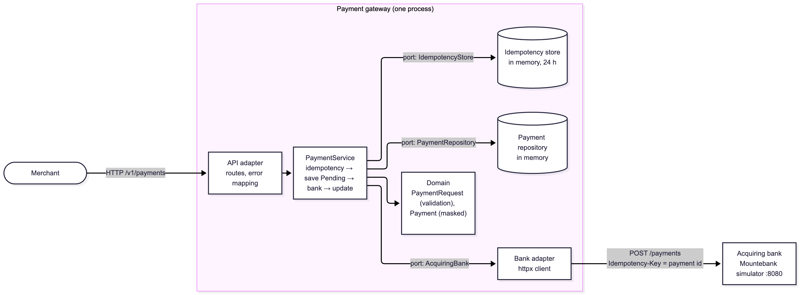
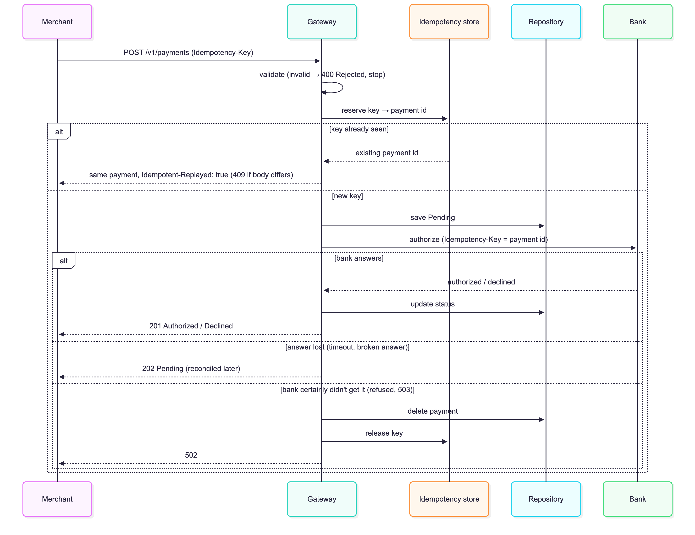
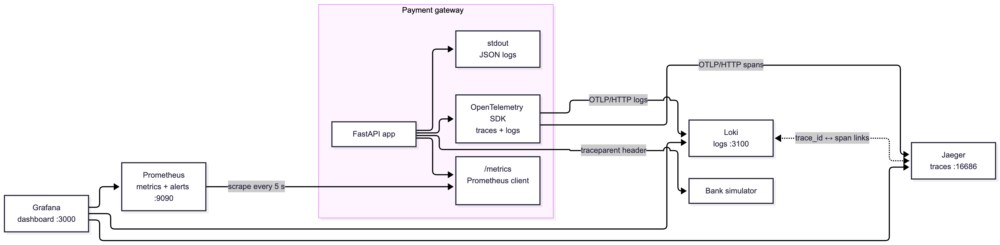
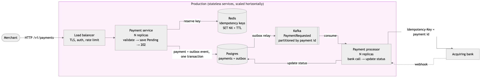

# Payment Gateway

An API that lets merchants take card payments and look them up later, built for the
[Checkout.com take-home](https://github.com/cko-recruitment).

This README follows the shape of a system design interview: requirements first, then the API, the high-level design,
deep dives on the hard parts, observability, and how it would grow. To just run it, jump to
[Running it](#9-running-it).

1. [Requirements](#1-requirements)
2. [API design](#2-api-design)
3. [High-level design](#3-high-level-design)
4. [Payment flow](#4-payment-flow)
5. [Deep dives](#5-deep-dives)
6. [Observability design](#6-observability-design)
7. [Assumptions and trade-offs](#7-assumptions-and-trade-offs)
8. [Taking it to production](#8-taking-it-to-production)
9. [Running it](#9-running-it)

## 1. Requirements

### Functional (from the brief)

- **Process a payment**: validate it, ask the acquiring bank to authorize it, and return its status: `Authorized`,
`Declined` (the bank said no) or `Rejected` (invalid input, the bank is never called).
- **Retrieve a payment** by id: status, last four card digits, expiry, currency, amount. Never the full card number.
- **Bank**: a Mountebank simulator. Card ending odd → authorized, even → declined, `0` → `503`.

### Non-functional


| Requirement                 | What it means here                                                                                                 |
| --------------------------- | ------------------------------------------------------------------------------------------------------------------ |
| **Never charge twice**      | A merchant retry after a timeout must not reach the bank a second time.                                            |
| **Never lose a charge**     | If the bank's answer is lost, the payment must still exist and be traceable.                                       |
| **Card data stays secret**  | Full card number and CVV never stored, logged or returned.                                                         |
| **Bounded latency**         | One bank call, with a timeout (5 s). The merchant always gets an answer.                                           |
| **Observable**              | Any single payment can be followed through logs, traces and metrics.                                               |
| **Simple and maintainable** | The brief says not to over-engineer: build what is asked, plus only what a payment system can't safely go without. |


### Out of scope

Database, message broker, authentication, rate limiting, retries, circuit breaker. Each one is discussed in
[Taking it to production](#8-taking-it-to-production).

## 2. API design

### `POST /v1/payments`

```bash
curl -i localhost:8000/v1/payments \
  -H 'Content-Type: application/json' \
  -H 'Idempotency-Key: order-42' \
  -d '{"card_number": "2222405343248877", "expiry_month": 4, "expiry_year": 2030,
       "currency": "GBP", "amount": 1050, "cvv": "123"}'
```

```http
HTTP/1.1 201 Created
Location: /v1/payments/7c4a1c2e-5b0f-4c6e-9a63-2f8d1e3b9a10

{"id": "7c4a1c2e-5b0f-4c6e-9a63-2f8d1e3b9a10", "status": "Authorized", "last_four": "8877",
 "expiry_month": 4, "expiry_year": 2030, "currency": "GBP", "amount": 1050}
```


| Outcome                                       | HTTP        | Body                                                       | Why                                                                                   |
| --------------------------------------------- | ----------- | ---------------------------------------------------------- | ------------------------------------------------------------------------------------- |
| Authorized **or Declined**                    | `201`       | The payment, `Location` header                             | The bank answered and a payment exists. A decline is a business result, not an error. |
| Rejected: invalid input                       | `400`       | `{"status": "Rejected", "errors": [{"field", "message"}]}` | The request is wrong. Bank not called, nothing stored.                                |
| Bank answer lost (timeout, broken answer)     | `202`       | The payment, `"status": "Pending"`, `Location`             | The card may have been charged, so the payment exists and can be followed with `GET`. |
| Same `Idempotency-Key`, same body             | `201`/`202` | The original payment, `Idempotent-Replayed: true`          | A retry. The bank is not called again.                                                |
| Same key, different body                      | `409`       | `{"error": "..."}`                                         | The key belongs to another payment.                                                   |
| Bank certainly didn't get it (refused, `503`) | `502`       | `{"error": "..."}`                                         | Upstream failure. Nothing happened, so nothing is stored.                             |


### `GET /v1/payments/{id}`

`200` with the same body as `POST` and `Cache-Control: no-store` (no proxy keeps card data), or `404` for an unknown
**or malformed** id: for the merchant, both mean "no such payment".

### `GET /health` and `GET /metrics`

`/health` returns `200 {"status": "ok"}` while the process answers (Docker `HEALTHCHECK`, Kubernetes liveness). It does
not check the bank on purpose: a bank outage must not get the gateway restarted. `/metrics` is for Prometheus (see
[Observability](#6-observability-design)).

Every status code is in the OpenAPI schema at `/docs`, with its body model.

### Validation


| Field          | Rule                                                  |
| -------------- | ----------------------------------------------------- |
| `card_number`  | String of 14-19 digits                                |
| `expiry_month` | Integer 1-12                                          |
| `expiry_year`  | 4-digit integer; month + year must not be in the past |
| `currency`     | `USD`, `GBP` or `EUR`                                 |
| `amount`       | Integer &gt; 0, in minor units (`1050` = 10.50)       |
| `cvv`          | String of 3-4 digits                                  |


- **One Pydantic model** (`PaymentRequest`) holds every rule and is also the request body: one place to read and test,
and the Swagger schema comes free.
- **Strict types**: `"100"`, `100.0` and `true` are rejected for integers instead of converted. On a money path a
merchant bug should fail loudly.
- **Card number and CVV are strings**, because they can start with `0`.
- **Every bad field is reported at once**, and the submitted value is **never echoed** (it could be a card number).

### Versioning: `/v1` in the URL

A breaking change goes to `/v2`, served next to `/v1` until merchants have moved. Additive changes (a new optional field,
a new endpoint) stay in `/v1`. The URL beats a header because it is visible in every log line, trivial to route at a
load balancer and impossible to forget. `/health` and `/metrics` are for our infrastructure, so they are not versioned.

## 3. High-level design



**Ports and adapters, kept small.** Business rules in the middle, I/O at the edges:

- `domain/` (validation, the `Payment` model) knows nothing about FastAPI or httpx.
- `application/payment_service.py` holds the flow and talks to the outside only through three small interfaces in
`ports.py`.
- `adapters/` has one folder per outside world: `api/` (merchants call us), `bank/` (we call the bank), `storage/`.

**Why:** the simulator and the in-memory storage are stand-ins. Swapping them for a real acquirer, Postgres or Redis
means writing a new adapter; the rules, the flow and their tests don't change.

**Why not more:** one `PaymentService` with two methods (`process`, `get`) instead of a class per use case, no DTO
layer, no DI framework: `app.py` wires everything by hand. One shared `httpx.AsyncClient`, opened at startup and closed
at shutdown, pools connections to the bank.

## 4. Payment flow



## 5. Deep dives

### 5.1 Never charge twice: idempotency keys

The one thing added beyond the brief. Networks fail and merchants retry; without it, a retry after a timeout can
**charge the customer twice**, the worst bug a payment gateway can have. It costs ~60 lines.

The optional `Idempotency-Key` header points to the payment from the moment it is saved as `Pending` (before the bank
call) and lasts 24 h. A repeated key gets:

- **Same body**: the payment as it is now, `Idempotent-Replayed: true`, bank **not called**. `201` once the bank
answered, `202` while still `Pending`.
- **Different body**: `409 Conflict`.
- **After a "bank certainly didn't get it" failure**: the key was freed, so the retry is processed as new.

Two identical requests at once can't both reach the bank: reserving the key has no `await`, so it can't be
interleaved. The bank gets **our payment id** as its idempotency key, not the merchant's key.

### 5.2 Never lose a charge: save `Pending` before the bank call

- The payment is saved as `Pending` **before** the bank is called. When the bank answers, it becomes `Authorized` or
`Declined`.
- A timeout or broken answer may still have charged the card. Answering `Declined` would invite the merchant to charge
again; storing nothing would leave a charge nobody can trace. So it **stays `Pending`**, the merchant gets `202` with
its id, and a reconciliation job (see [Resilience](#resilience)) would settle it. A crash mid-call leaves it
`Pending` too.
- If the bank **certainly didn't get** the request (connection refused, `503`), the payment is deleted and the merchant
gets `502`.
- **One bank attempt, no automatic retries.** Blind retries on a money path are how customers get charged twice. The
merchant retries safely with an idempotency key.

### 5.3 Card data stays secret

- Full card number and CVV are **never stored, logged or returned**. Only the last four digits are kept. The bank's
authorization code isn't stored either: the brief doesn't need it.
- The idempotency store compares requests by an **HMAC** of the body (random secret per process), not the body itself,
and not a plain SHA-256, which could be brute-forced back into a card number.
- `GET` answers carry `Cache-Control: no-store`.

### 5.4 Storage in memory

The brief allows it. Payments and keys live in dictionaries behind the `PaymentRepository` and `IdempotencyStore`
ports, so moving to a database is an adapter change. The cost: data is lost on restart and not shared between
instances, so the gateway runs as **one process**.

## 6. Observability design

A payment gateway you can't see into is one you can't run. Three signals, **all linked by the trace id**, so a
merchant's complaint about one payment leads to its logs, its trace and the bank call inside it.



### Signals


| Signal      | How                                                                                      | What you get                                                                                                                                     |
| ----------- | ---------------------------------------------------------------------------------------- | ------------------------------------------------------------------------------------------------------------------------------------------------ |
| **Logs**    | JSON on stdout, always. Also OTLP → Loki when `OTEL_EXPORTER_OTLP_LOGS_ENDPOINT` is set. | One line per event, values as fields, `trace_id` and `span_id` on every line (uvicorn's access log too).                                         |
| **Traces**  | OpenTelemetry, OTLP → Jaeger when `OTEL_EXPORTER_OTLP_ENDPOINT` is set.                  | A span per request and per bank call (`POST acquiring-bank /payments`, `peer.service=acquiring-bank`). Request spans tagged `payment.id`, `payment.status`, `payment.replayed`. The bank receives the W3C `traceparent` header. |
| **Metrics** | Prometheus scrapes `GET /metrics`.                                                       | RED metrics per endpoint plus business metrics (below).                                                                                          |


A log line:

```json
{"timestamp": "...", "level": "INFO", "logger": "payments.application.payment_service",
 "message": "payment_processed", "payment_id": "fc2475bb-...", "status": "Authorized", "amount": 1050,
 "currency": "GBP", "replayed": false, "trace_id": "25fec9811bb6...", "span_id": "7fd449af4a1c..."}
```

Card data never reaches a log call, and a test checks it. Without the OTLP endpoints, trace ids are still created and
written in the logs.

### Metrics


| Metric                                                 | Answers                                                             |
| ------------------------------------------------------ | ------------------------------------------------------------------- |
| `http_requests_total`, `http_request_duration_seconds` | Rate, errors and latency per endpoint (RED)                         |
| `payments_total{status}`                               | How many payments are authorized, declined, rejected, left pending  |
| `bank_request_duration_seconds{outcome}`               | Is the bank slow or failing, and how (timeout, refused, bad answer) |
| `idempotent_replays_total`                             | How often merchants retry                                           |


### Alerts (`observability/alerts.yml`)


| Alert                 | Fires when                                                  |
| --------------------- | ----------------------------------------------------------- |
| `GatewayDown`         | Prometheus can't scrape the gateway for 1 min               |
| `BankFailing`         | Over 5% of bank calls fail for 2 min                        |
| `PaymentsLeftPending` | Any payment left `Pending` in 10 min (needs reconciliation) |
| `DeclineSpike`        | Over half of payments declined for 5 min                    |
| `SlowRequests`        | p95 latency of the payments API over 1 s for 5 min          |


### Dashboard and links

Grafana is provisioned from `observability/grafana/`: Prometheus, Jaeger and Loki data sources, and a
"Payment Gateway" dashboard (payments/s, decline rate, bank failure rate, pending, latency, logs).

- In a **log line**, the `trace_id` field opens the trace in Jaeger.
- On a **span**, "Logs for this span" opens its log lines in Loki.

No OTel collector locally: the gateway sends straight to Jaeger and Loki. In production a collector would sit in
between (see [below](#observability)).

### Run it

```bash
docker compose up -d                                        # bank simulator
docker compose -f docker-compose.observability.yml up -d    # Jaeger, Loki, Prometheus, Grafana
OTEL_EXPORTER_OTLP_ENDPOINT=http://localhost:4318 \
OTEL_EXPORTER_OTLP_LOGS_ENDPOINT=http://localhost:3100/otlp/v1/logs make run
```

Grafana [http://localhost:3000](http://localhost:3000), Jaeger [http://localhost:16686](http://localhost:16686), alerts [http://localhost:9090/alerts](http://localhost:9090/alerts).

## 7. Assumptions and trade-offs

### Assumptions

- A card is valid until the end of its expiry month (UTC). The current month is accepted.
- Three currencies are enough (the brief caps the list at 3): `USD`, `GBP`, `EUR`, exact uppercase.
- `amount` is in minor units with no upper limit: the bank enforces that.
- A bank `503` means "not processed", as HTTP defines it, so it is safe to send again.
- Any other bank failure (timeout, other error status, unreadable body) means "outcome unknown": the payment stays
`Pending`.
- No authentication on `GET`: ids are random UUID4s and the response holds no full card number. In production each
payment would belong to a merchant, and another merchant's id would return `404`.

### Trade-offs


| Chose                              | Over                         | Because                                                                                                |
| ---------------------------------- | ---------------------------- | ------------------------------------------------------------------------------------------------------ |
| Synchronous bank call              | Queue + worker               | Simple; the merchant gets the result in one call. Async is the scaling path.                           |
| In-memory storage                  | Database                     | Allowed by the brief; ports make the swap an adapter change. Costs: lost on restart, one process only. |
| One bank attempt                   | Retries, circuit breaker     | Blind retries risk double charges; idempotency keys let the merchant retry safely.                     |
| `Pending` + `202` on a lost answer | `Declined` or nothing stored | Neither invites a double charge nor loses a real one.                                                  |
| Idempotency keys                   | Strict minimalism            | The one addition: it prevents the worst bug a gateway can have.                                        |
| Version in the URL                 | Version header               | Visible in logs, easy to route, impossible to forget.                                                  |


## 8. Taking it to production

None of this is built, on purpose. Roughly in this order:

### Scaling: state out of the process, bank call behind a broker

1. **Move state out**: payments in Postgres, idempotency keys in Redis (`SET NX` with a TTL replaces the in-memory
 reservation). The API becomes stateless.
2. **Decouple the bank call with Kafka**:
   - The **payment service** validates, saves the payment as `Pending`, publishes `PaymentRequested` and answers `202`
    right away. Save and publish go through an **outbox table** in one transaction, so no event is lost or sent for an
    unsaved payment.
   - A **payment processor** consumes the event, calls the bank with the idempotency key (a redelivered event can't
   charge twice), and updates the status. The bank can also notify us later via **webhook**.
   - The merchant polls `GET /v1/payments/{id}` or receives **our webhook**.
3. **Scale horizontally**: both services are stateless. Kafka partitions keyed by payment id spread the load while
 keeping each payment's events in order. A slow bank fills a queue instead of failing merchant requests.



### Resilience

- **Retries with backoff**, only when the bank certainly didn't process the request (connection refused, `503`).
- **A circuit breaker**, so a failing bank isn't hammered and merchants get a fast answer.
- **A reconciliation job** that asks the bank, by payment id, for the outcome of every `Pending` payment and settles it.

### Observability

- **An OTel collector** between the gateway and the backends, to batch, sample (keep every error, a share of the rest)
and switch vendor (Datadog, Honeycomb) without code changes.
- **A log filter that masks anything that looks like a card number**, as a safety net before logs leave the process.
- **SLOs and paging**: e.g. 99.9% of payments answered under 1 s, Alertmanager paging on burn rate, not raw thresholds.
- **Merchant id** on every log, span and metric once authentication exists ("is it just this merchant?").

### Security and compliance

- **Merchant authentication** (API keys or OAuth2), each payment owned by a merchant.
- **Rate limiting** per merchant.
- **PCI DSS**: card data to a tokenization vault so the gateway only handles tokens, TLS everywhere, secrets in a
secret manager.

### Hosting

The image fits any container platform. On Kubernetes:

- `/health` as **liveness**; a **readiness** probe that checks the database and Redis once they exist (not the bank: a
slow bank should queue work, not take pods out of rotation).
- **One replica** until state leaves the process, then a Deployment with an autoscaler.
- Settings from a ConfigMap, secrets from a secret manager, TLS at the ingress.
- Rolling deploys: uvicorn finishes in-flight requests on `SIGTERM`, so no payment is cut mid-bank-call.
- CI pushes the image tagged with the git SHA and deploys to staging, then production.

### Load testing

Before going live, a [Locust](https://locust.io) or [k6](https://k6.io) test with a realistic mix (mostly authorized,
some declined, rejected, replays and `GET`s), pass/fail thresholds (e.g. &lt; 1% errors, p95 &lt; 500 ms) so it can gate a
pipeline, and several shapes: steady, spike, and soak (to catch the in-memory stores growing). Run in CI against
staging, and again after each scaling change.

## 9. Running it

Needs Python 3.12+, Poetry and Docker.

```bash
make install            # poetry install
docker compose up -d    # bank simulator on :8080 (Mountebank admin API on :2525)
make run                # API on :8000, Swagger UI on http://localhost:8000/docs
make test               # all tests; e2e tests skip themselves if the simulator is down
```

With observability: see [Run it](#run-it).


| Command                                            | Does                                            |
| -------------------------------------------------- | ----------------------------------------------- |
| `make test-unit` / `test-integration` / `test-e2e` | One test type only                              |
| `make coverage`                                    | Tests with a coverage report                    |
| `make lint`                                        | Ruff lint + format check (`make format` to fix) |
| `make docker-build` / `docker-run`                 | Build and run the gateway image                 |


### Configuration

Environment variables, validated at startup. `.env` is read too, but real variables win (see `.env.example`). Every
setting has a default.


| Variable                           | Default                 |                                                                                |
| ---------------------------------- | ----------------------- | ------------------------------------------------------------------------------ |
| `BANK_URL`                         | `http://localhost:8080` | Acquiring bank                                                                 |
| `BANK_TIMEOUT_SECONDS`             | `5`                     | Per bank call                                                                  |
| `LOG_LEVEL`                        | `INFO`                  | `DEBUG`, `INFO`, `WARNING` or `ERROR`                                          |
| `DOCS_ENABLED`                     | `true`                  | Serve `/docs`, `/redoc`, `/openapi.json`                                       |
| `OTEL_EXPORTER_OTLP_ENDPOINT`      | unset                   | Send spans over OTLP/HTTP (e.g. `http://localhost:4318`)                       |
| `OTEL_EXPORTER_OTLP_LOGS_ENDPOINT` | unset                   | Send logs over OTLP/HTTP, full URL (e.g. `http://localhost:3100/otlp/v1/logs`) |


### Project structure

```java
main.py                         # make run: uvicorn on :8000 (dev, auto-reload)
Dockerfile                      # production image
.github/workflows/ci.yml        # lint, all tests with the simulator, image build
docker-compose.yml              # bank simulator
docker-compose.observability.yml
observability/                  # Prometheus config + alerts, Grafana data sources (trace <-> log links) + dashboard
src/
├── app.py                      # create_app(): wires everything together
├── config.py                   # settings from environment variables
├── observability.py            # logs, tracing, HTTP metrics, /health (knows nothing about payments)
└── payments/
    ├── domain/                 # no FastAPI, no httpx
    │   ├── payment.py          # PaymentRequest (validation), Payment (masked), PaymentStatus
    │   └── errors.py
    ├── application/
    │   ├── ports.py            # AcquiringBank, PaymentRepository, IdempotencyStore
    │   └── payment_service.py  # idempotency key -> save Pending -> bank -> update
    └── adapters/
        ├── api/                # in: merchants call us over HTTP
        │   ├── routes.py
        │   └── errors.py       # error bodies, errors -> HTTP status codes
        ├── bank/               # out: we call the acquiring bank
        │   └── mountebank.py
        ├── storage/            # out: in memory, a database later
        │   ├── payment_repository.py
        │   └── idempotency_store.py
        └── metrics.py          # payment and bank metrics
```

### Tests

`tests/` mirrors `src/`; the file suffix gives the type.


| Suffix                 | Type        | Covers                                                          | Run                     |
| ---------------------- | ----------- | --------------------------------------------------------------- | ----------------------- |
| `_unit_spec.py`        | Unit        | One class or function: validation, service, bank client, stores | `make test-unit`        |
| `_integration_spec.py` | Integration | The whole app over HTTP with a stub bank; logs, traces, metrics | `make test-integration` |
| `_e2e_spec.py`         | E2E         | The whole app against the real bank simulator                   | `make test-e2e`         |


- The **stub bank** records calls, which proves the bank is never called for a `Rejected` payment or a replay. The bank
client's unit tests fake HTTP with `httpx.MockTransport`.
- **E2E**: `payments_e2e_spec.py` uses the simulator's card rules (authorized, declined, bank error, rejected,
replay, conflict, `GET`, `404`, card data never returned). `bank_scenarios_e2e_spec.py` programs the simulator
through Mountebank's API (`:2525`) for what card rules can't cover: exact wire format, a slow bank (`Pending`, retry
never reaches the bank), a `503` then a successful retry, and unusable answers (`500`, `400`, bad JSON). Each stub
matches only its test's random amount and is removed afterwards.

### Docker and CI

```bash
make docker-build       # image: payment-gateway
make docker-run         # API on :8000, talks to the simulator on the host
```

The image is **two-stage** (runtime dependencies and `src/` only: no Poetry, dev tools or tests), runs as a
**non-root** user without auto-reload, is configured only by environment variables, has a **`HEALTHCHECK`** on
`/health`, and runs **one worker** (state is in memory).

GitHub Actions runs on every push and pull request:

1. **test**: `make lint`, starts the simulator, waits for it (so e2e tests can't silently skip), runs every test with
 coverage.
2. **docker**: builds the image, starts it, waits for `/health`, so a broken image fails the build.